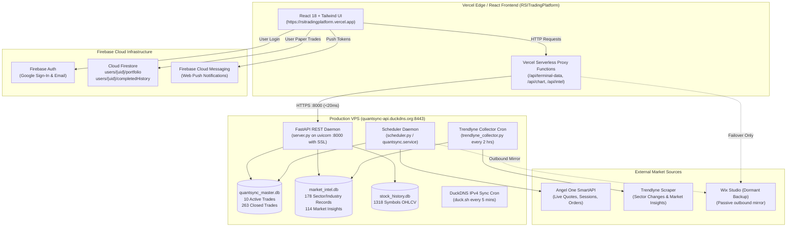

# QuantSync VPS Architecture, API Specification & Deployment Reference

> **Target Audience:** Future AI Agents, Autonomous LLMs, and Human Engineers.
> This document details the 100% complete architecture, API contract, dynamic DNS, SSL setup, and frontend integration of the QuantSync trading ecosystem.

---

## 1. High-Level System Architecture



---

## 2. VPS Server Details & Environment

* **Operating System:** Ubuntu 24.04 LTS (x86_64)
* **Default Working Directory:** `/root/quantsync`
* **Python Environment:** `/root/quantsync/venv` (Python 3.12+)
* **Public Domain:** `quantsync-api.duckdns.org`
* **API Port:** `8000` (HTTPS / TLS 1.3 via Let's Encrypt)
* **Service Manager:** `systemd`

---

## 3. Dynamic DNS (DuckDNS) & Free SSL Architecture

### DuckDNS Setup
To avoid expensive static IP domain setups and allow seamless migration between cheap cloud VPS providers, the system uses DuckDNS with automated IP synchronization:

* **Subdomain:** `quantsync-api.duckdns.org`
* **DuckDNS Token:** `fb541758-536a-4348-acab-29d8993dbd96`
* **Update Script Path:** `/root/duckdns/duck.sh`
* **Update Command:**
  ```bash
  echo url="https://www.duckdns.org/update?domains=quantsync-api&token=fb541758-536a-4348-acab-29d8993dbd96&ip=162.19.81.219&ipv6=" | curl -k -s -o /root/duckdns/duck.log -K -
  ```
  *(Note: `&ipv6=` is explicitly left blank to clear any AAAA record and pin pure IPv4 routing).*

### Automated Cron Job
In `/var/spool/cron/crontabs/root`:
```cron
*/5 * * * * /root/duckdns/duck.sh >/dev/null 2>&1
0 */2 * * * /root/quantsync/scripts/sync_trendlyne.sh
@reboot /root/duckdns/duck.sh >/dev/null 2>&1
```

### Let's Encrypt SSL Certificates
Certificates are managed via `certbot`:
* **Certificate Fullchain:** `/etc/letsencrypt/live/quantsync-api.duckdns.org/fullchain.pem`
* **Private Key:** `/etc/letsencrypt/live/quantsync-api.duckdns.org/privkey.pem`
* **Auto-renewal:** Run via Certbot DNS-01 hooks (`duckdns-auth.sh` & `duckdns-cleanup.sh`).

---

## 4. Complete REST API Catalog (Port 8000)

All endpoints accept CORS from any origin (`*`) and return JSON in $< 20\text{ ms}$.

### 4.1. Terminal & Trading Engine Endpoints

| Endpoint | Method | Params | Description | SQLite Source |
| :--- | :---: | :--- | :--- | :--- |
| `/api/terminalData` | `GET` | `version=v2` or `v3` | Full portfolio snapshot: Active trades, Closed ledger, toBuy signals, KPIs | `quantsync_master.db` |
| `/api/terminalDataV3`| `GET` | — | Alias for `/api/terminalData?version=v3` | `quantsync_master.db` |
| `/api/signals` | `GET` | `limit=100` | Ranked Buy Now / Wait signals with star ratings | `quantsync_master.db` |
| `/api/active-trades`| `GET` | — | Currently open book positions in Wix-compatible format | `quantsync_master.db` |
| `/api/closed-trades`| `GET` | `limit=100, offset=0` | Full historical ledger of closed trades (263 records) | `quantsync_master.db` |
| `/api/upcoming-stocks`| `GET` | — | Candidate stocks near breakout/pullback setup | `quantsync_master.db` |
| `/api/kpis` | `GET` | — | Win rate (55.1%), Profit factor (1.92), Total Return (38.08%) | `quantsync_master.db` |
| `/health` | `GET` | — | Health check, uptime timestamp, and API version | In-memory |

#### Sample Response: `/api/terminalData?version=v2`
```json
{
  "system": "QuantSync-V2",
  "inTradeTrades": [
    {
      "symbol": "VIJAYA",
      "action": "HOLD",
      "actionLabel": "IN POSITION",
      "actionColor": "blue",
      "entryPrice": 1510.6,
      "currentPrice": 1554.9,
      "currentROI": 2.93,
      "stopLoss": 1412.0,
      "targetPrice": 1737.19,
      "shares": 10,
      "starsDisplay": "★★★★½",
      "strategyName": "Breakout"
    }
  ],
  "closedTrades": [
    {
      "tradeId": "TRD_00001",
      "symbol": "RBZJEWEL",
      "strategyName": "Apex",
      "entryPrice": 228.29,
      "exitPrice": 231.71,
      "returnPct": 1.5,
      "holdingDays": 2
    }
  ],
  "toBuySignals": [ ... 7 signals ... ],
  "kpis": {
    "totalStocks": 1318,
    "activeCount": 10,
    "totalTradesClosed": 263,
    "wins": 145,
    "losses": 118,
    "winRate": 55.1,
    "profitFactor": 1.92,
    "totalReturnPct": 38.08
  },
  "source": "quantsync-vps-live"
}
```

---

### 4.2. Candlestick Chart Engine

| Endpoint | Method | Params | Description | SQLite Source |
| :--- | :---: | :--- | :--- | :--- |
| `/api/chart/{symbol}` | `GET` | `limit=250` | 250 daily OHLCV candles formatted for lightweight-charts | `stock_history.db` |

#### Sample Response: `/api/chart/TCS?limit=3`
```json
{
  "symbol": "TCS",
  "count": 3,
  "data": [
    { "time": "2026-09-16", "open": 4210.0, "high": 4255.0, "low": 4195.5, "close": 4240.2, "volume": 1250300 },
    { "time": "2026-09-17", "open": 4245.0, "high": 4280.0, "low": 4230.0, "close": 4268.5, "volume": 1102400 },
    { "time": "2026-09-18", "open": 4270.0, "high": 4310.0, "low": 4265.0, "close": 4295.0, "volume": 1450200 }
  ]
}
```

---

### 4.3. Market Intelligence (Trendlyne Data)

| Endpoint | Method | Params | Description | SQLite Source |
| :--- | :---: | :--- | :--- | :--- |
| `/api/intel/stats` | `GET` | — | Summary counts of sectors, industries, news items | `market_intel.db` |
| `/api/intel/sectors`| `GET` | `period=day` or `week` | 59 Indian stock sectors ranked by % performance | `market_intel.db` |
| `/api/intel/industries` | `GET` | `period=day` or `week` | Granular industry classification breakdown | `market_intel.db` |
| `/api/intel/indices`| `GET` | `period=day` or `week` | Benchmark indices (Nifty 50, Nifty Bank, Next 50) | `market_intel.db` |
| `/api/intel/news` | `GET` | `limit=50, stock=INFY` | Live financial insights & corporate news headlines | `market_intel.db` |
| `/api/intel/trigger-collector` | `POST` | — | Manually triggers an immediate Trendlyne scrape | `market_intel.db` |

---

## 5. SQLite Databases Specification

All databases reside in `/root/quantsync/Data/`:

### 5.1. `quantsync_master.db` (Master Ledger)
* **`active_trades`**: Active algo positions.
  * Columns: `trade_id (PK)`, `engine_version`, `symbol`, `strategy_id`, `entry_date`, `entry_price`, `current_stop`, `target_price`, `shares`, `invested_capital`, `current_ltp`, `unrealized_pnl`, `status`
* **`closed_trades`**: Completed historical ledger (263 trades).
  * Columns: `trade_id (PK)`, `symbol`, `strategy_id`, `entry_date`, `exit_date`, `entry_price`, `exit_price`, `shares`, `gross_pnl`, `net_pnl`, `exit_reason`, `holding_days`
* **`daily_nav`**: Mark-to-market daily portfolio NAV tracking.

### 5.2. `market_intel.db` (Market Intelligence)
* **`trendlyne_performance`**: Historical sector & industry records.
* **`trendlyne_current_performance`**: Latest snapshot with 1-day & 1-week change %.
* **`trendlyne_market_insights`**: News feeds, earnings alerts, and macro commentary.

### 5.3. `stock_history.db` (Candle Store)
* **`StockHistory`**: 1,318 symbols with daily OHLCV rows for charting.

---

## 6. Frontend Integration (`RSITradingPlatform` on Vercel)

The React application on Vercel uses a clean proxy layer to shield client browsers from VPS CORS and provide seamless failover:

### 6.1. Route Mapping Table

| Frontend / React Route | Vercel Serverless Function | Target VPS Endpoint | Fallback (if VPS down) |
| :--- | :--- | :--- | :--- |
| `API_ENDPOINTS.terminalData('v2')` | `/api/terminal-data?version=v2` | `quantsync-api.duckdns.org:8443/api/terminalData?version=v2` | Wix `_functions/terminalData` |
| `API_ENDPOINTS.upcomingStocks` | `/api/upcoming-stocks` | `quantsync-api.duckdns.org:8443/api/upcoming-stocks` | Empty array (graceful) |
| `API_ENDPOINTS.chart(sym)` | `/api/chart?symbol=sym` | `quantsync-api.duckdns.org:8443/api/chart/sym` | Cached mock candles |
| `API_ENDPOINTS.intelSectors()` | `/api/intel?type=sectors` | `quantsync-api.duckdns.org:8443/api/intel/sectors` | Cached sectors |
| `API_ENDPOINTS.intelNews()` | `/api/intel?type=news` | `quantsync-api.duckdns.org:8443/api/intel/news` | Cached news |
| Custom Overview Feed | `/api/feeds/overview` | Aggregates VPS sectors + news | Cached bundle |

### 6.2. User & Paper Trading Layer (Firebase)
* **Authentication:** Managed by Firebase Auth (`firebase/auth`).
* **Paper Portfolios:** Stored in Cloud Firestore under `users/{uid}`:
  * `portfolio`: User's simulated open positions.
  * `completedHistory`: User's simulated closed trades.
  * **Wix has ZERO involvement in user accounts or paper portfolios.**

---

## 7. Systemd Daemons & Background Services

### 7.1. `quantsync_api.service` (REST API Server)
File: `/etc/systemd/system/quantsync_api.service`
```ini
[Unit]
Description=QuantSync Production FastAPI REST Server
After=network.target

[Service]
Type=simple
User=root
WorkingDirectory=/root/quantsync
ExecStart=/root/quantsync/venv/bin/uvicorn server:app --host 0.0.0.0 --port 8443 --workers 1 --ssl-keyfile /etc/letsencrypt/live/quantsync-api.duckdns.org/privkey.pem --ssl-certfile /etc/letsencrypt/live/quantsync-api.duckdns.org/fullchain.pem
Restart=always
RestartSec=3
StandardOutput=append:/root/quantsync/logs/api_server.log
StandardError=append:/root/quantsync/logs/api_server.log

[Install]
WantedBy=multi-user.target
```

### 7.2. `quantsync.service` (Autonomous Scheduler)
File: `/etc/systemd/system/quantsync.service`
```ini
[Unit]
Description=QuantSync Multi-Engine Autonomous Trading Scheduler
After=network.target

[Service]
Type=simple
User=root
WorkingDirectory=/root/quantsync
ExecStart=/root/quantsync/venv/bin/python3 scheduler.py
Restart=always
RestartSec=10
StandardOutput=append:/root/quantsync/logs/scheduler.log
StandardError=append:/root/quantsync/logs/scheduler.log

[Install]
WantedBy=multi-user.target
```

---

## 8. Complete Disaster Recovery & Migration Guide

To migrate the entire system to a new VPS (e.g. ₹199/month Hetzner or DigitalOcean droplet):

### Step 1: Tar the project on old VPS (or take local replica `vps_data_live`)
```bash
tar -czvf quantsync_backup.tar.gz /root/quantsync /root/duckdns
scp quantsync_backup.tar.gz root@[NEW_VPS_IP]:/root/
```

### Step 2: Extract & Install Dependencies on New VPS
```bash
cd /root && tar -xzvf quantsync_backup.tar.gz
apt-get update && apt-get install -y python3 python3-venv sqlite3 certbot curl
cd /root/quantsync && python3 -m venv venv
venv/bin/pip install fastapi uvicorn requests beautifulsoup4
```

### Step 3: Repoint DuckDNS to New VPS IP
```bash
curl "https://www.duckdns.org/update?domains=quantsync-api&token=fb541758-536a-4348-acab-29d8993dbd96&ip="
```

### Step 4: Issue Free SSL Certificate
```bash
certbot certonly --standalone -d quantsync-api.duckdns.org --agree-tos --register-unsafely-without-email --non-interactive
```

### Step 5: Start Services & Crontab
```bash
cp /root/quantsync/quantsync_api.service /etc/systemd/system/
cp /root/quantsync/quantsync.service /etc/systemd/system/
systemctl daemon-reload
systemctl enable --now quantsync_api.service quantsync.service

# Setup cron:
(echo "*/5 * * * * /root/duckdns/duck.sh >/dev/null 2>&1"; \
 echo "0 */2 * * * /root/quantsync/scripts/sync_trendlyne.sh"; \
 echo "@reboot /root/duckdns/duck.sh >/dev/null 2>&1") | crontab -
```

**Result:** Migration is 100% complete. Because the Vercel frontend references `quantsync-api.duckdns.org:8443`, the frontend automatically reconnects to the new server with **zero downtime and zero code changes.**
